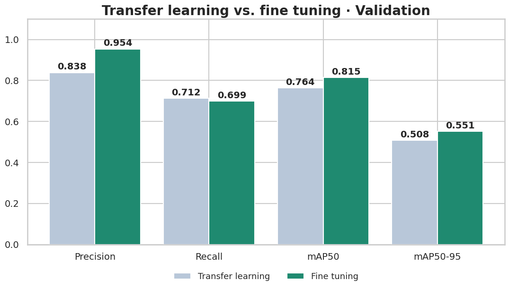
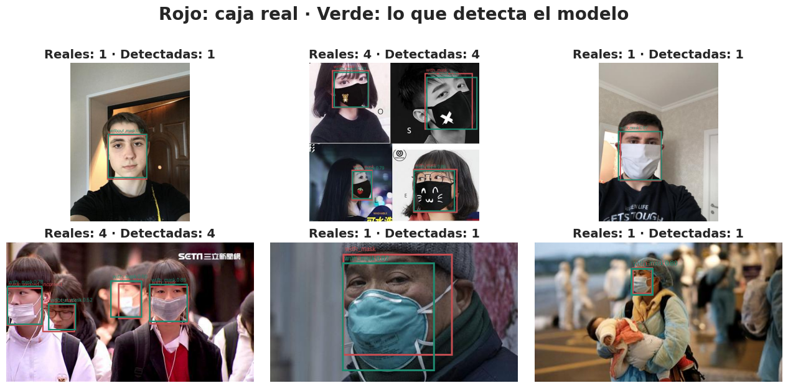
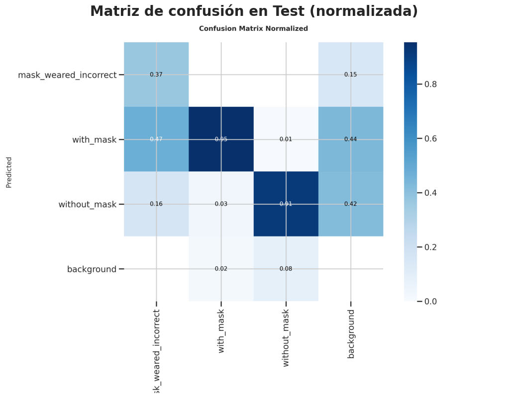
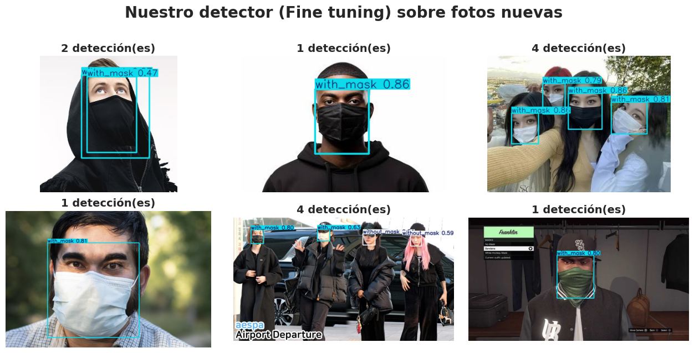
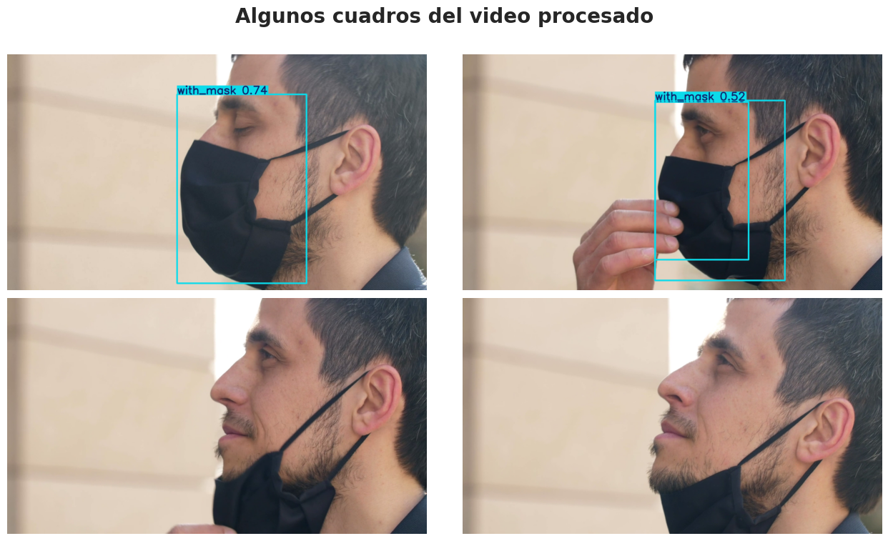

# Detección del uso de mascarilla con YOLO26

**Proyecto universitario de Machine Learning — Universidad Bernardo O'Higgins**
Autores: Cristóbal Araos · Martín Garrido

[](https://colab.research.google.com/github/GuFfy0921/mask_yolo_detection/blob/main/notebooks/mask_detection_yolo26.ipynb)


> Detector de visión por computador que localiza rostros y clasifica el estado de la mascarilla en tres clases: `with_mask`, `without_mask` y `mask_weared_incorrect`. Se plantea como un **complemento visual** para MediTriage, un sistema de apoyo al triaje de urgencias que clasifica la escala ESI a partir de los síntomas que describe el paciente. MediTriage "escucha"; este detector "observa".



## Resumen

| Ítem | Detalle |
|---|---|
| Tarea | Detección de objetos (caja + clase + confianza) |
| Modelo | YOLO26n preentrenado en COCO |
| Estrategia | Transfer learning (backbone congelado) → fine tuning (todas las capas, lr 5e-4) |
| Dataset | 848 imágenes reales, 4.021 cajas, partición 70/15/15 |
| Entrenamiento | Google Colab, GPU Tesla T4, ~6.7 min en total |
| Resultado final (Test) | mAP50 **0,781** · mAP50-95 **0,458** |
| Estado | Caso de uso propuesto: **no** integrado con MediTriage ni probado en una sala real |

## Problema y alcance

En una sala de espera, una persona con síntomas respiratorios que no usa mascarilla representa un riesgo que el triaje basado en texto no puede ver. Este trabajo entrena y evalúa un detector que podría avisar al personal de triaje o control de infecciones.

El alcance es explícito: **es una propuesta**, no un sistema clínico. No hay integración con MediTriage, no hay pruebas en un entorno real y no se trata de un detector de caras genérico (lo que se clasifica es el estado de la mascarilla sobre el rostro).

## Dataset

- [Mask Detection Computer Vision Dataset](https://universe.roboflow.com/iii-uimdg/mask-detection-vdfr3) (autor: III, dominio público), derivado de [Face Mask Detection](https://www.kaggle.com/datasets/andrewmvd/face-mask-detection) de andrewmvd.
- Se hizo un **fork propio (v1)** con las 848 fotos originales, sin aumentos ni redimensionado, y se exportó en formato YOLO26 con partición 70/15/15 ya aplicada en Roboflow. No se usa la v3 original: sus copias aumentadas y su Valid vacío impedían una partición limpia.
- Se verificó por nombre y hash que ninguna imagen se repite entre Train, Validation y Test. Las aumentaciones durante el entrenamiento las aplica Ultralytics solo sobre Train.

| Split | Imágenes | Cajas | Mal puesta | Bien puesta | Sin mascarilla |
|---|---:|---:|---:|---:|---:|
| Train | 594 | 2.925 | 90 | 2.340 | 495 |
| Validation | 127 | 496 | 12 | 412 | 72 |
| Test | 127 | 600 | 19 | 432 | 149 |

El ZIP exacto del dataset y el material externo (imágenes y video) se descargan automáticamente desde Google Drive dentro del notebook. Enlaces usados por el código:

- Dataset: `1pdJGrAHgVNjug_CPRdUongSOxQL8VTSd` — https://drive.google.com/file/d/1pdJGrAHgVNjug_CPRdUongSOxQL8VTSd/view
- Imágenes y video de prueba: `1VTpG-jnF6mV6Mcgvg_XXdpyUvhkLX6GH` — https://drive.google.com/file/d/1VTpG-jnF6mV6Mcgvg_XXdpyUvhkLX6GH/view

## Resultados

La elección del modelo se hizo **antes de mirar Test**: se eligió el de mayor mAP50-95 en Validation, que fue el fine tuning.

| Split | Precision | Recall | mAP50 | mAP50-95 |
|---|---:|---:|---:|---:|
| Validation (fine tuning) | 0,954 | 0,699 | 0,815 | 0,551 |
| **Test (fine tuning, una sola evaluación)** | **0,869** | **0,676** | **0,781** | **0,458** |

El transfer learning alcanzó 0,764 / 0,508 en Validation (mAP50 / mAP50-95). Aumentar las épocas de 10/5 a 50/25 fue la decisión con mayor impacto: el mAP50-95 pasó de 0,345 a 0,508 y de 0,350 a 0,551.

### Detecciones en Test





La clase `with_mask` se detecta bien (mAP50 de 0,94 en Validation) y `without_mask` razonablemente (0,82). La clase `mask_weared_incorrect` es débil: solo 0,37 de aciertos por clase en la matriz de Test, con 19 cajas de evaluación. El modelo tiende a confundir una mascarilla mal puesta con una bien puesta.

### Comportamiento fuera del dataset





Con imágenes y un video de Mixkit ajenos al dataset (10,2 s, procesado a ~59 FPS en T4) el modelo acierta en retratos de frente con mascarilla, pero pierde a la persona cuando la mascarilla baja del rostro en un video de perfil y trata una tela oscura que cubre la cara como si fuera mascarilla. Son ejemplos ilustrativos, no una medición de rendimiento.

## Limitaciones

1. La clase "mal puesta" tiene solo 121 cajas en total y el modelo apenas la distingue de la bien puesta.
2. Muchas caras son pequeñas; los objetos perdidos se concentran en rostros tapados, oscuros o diminutos.
3. El dataset contiene escenas de calle, estaciones y tiendas, distintas de una sala de espera.
4. Validation y Test son pequeños y se entrenó una sola vez por configuración: no hay estimación de variabilidad.
5. Parte de la ventaja del fine tuning puede deberse a las épocas adicionales (74 contra 49), no solo a descongelar capas.
6. La propuesta no se integró con MediTriage; con un recall de `without_mask` de 0,69 en Validation, no serviría como único control.

Trabajo futuro propuesto: comparar 416 vs 640 px, probar otros modelos base, repetir con distintas semillas, reforzar la clase minoritaria, ajustar el umbral de confianza priorizando recall y evaluar video real de una sala de espera con permisos.

## Estructura del repositorio

```text
.
├── notebooks/
│   └── mask_detection_yolo26.ipynb              # notebook ejecutado, con gráficos y métricas
├── reports/
│   └── informe_evaluacion03_mascarillas_yolo.pdf  # informe completo del proyecto
├── assets/                                      # figuras usadas en este README
├── requirements.txt
└── README.md
```

## Reproducción

El notebook está pensado para **Google Colab con GPU T4**. En local, las rutas de descarga de la Parte 3A están fijadas a `/content`, así que se recomienda ejecutarlo en Colab.

1. Abrir el notebook con un clic: [](https://colab.research.google.com/github/GuFfy0921/mask_yolo_detection/blob/main/notebooks/mask_detection_yolo26.ipynb) — o manualmente desde `notebooks/mask_detection_yolo26.ipynb` en [Google Colab](https://colab.research.google.com/).
2. `Entorno de ejecución → Cambiar tipo de entorno de ejecución → T4 GPU → Guardar`.
3. Ejecutar las celdas en orden (Parte 0 a Parte 10). El notebook descarga el ZIP del dataset y el material externo desde Google Drive.
4. Los modelos, figuras y métricas quedan en `resultados_c10/`; la Parte 10 genera un ZIP para descargar antes de cerrar la sesión.

Dependencias principales: `ultralytics`, `torch`, `opencv-python`, `PyYAML`, `numpy`, `pandas`, `matplotlib`, `seaborn`, `Pillow`, `gdown`, `kagglehub`. Ver `requirements.txt`.

## Créditos y licencias

- Notebook basado en la plantilla de la Clase 10 entregada por el profesor, con dataset y textos adaptados al problema.
- Dataset: dominio público (III / Kaggle andrewmvd). Video de prueba: licencia Mixkit.
- Ultralytics YOLO se distribuye bajo licencia AGPL-3.0; PyTorch y el resto de las librerías tienen sus propias licencias.
- Informe: Cristóbal Araos y Martín Garrido, Evaluación 03, Machine Learning, UBO, noviembre de 2026.

Este repositorio se publica con fines de portafolio académico. No constituye un dispositivo médico ni un sistema de verificación de cumplimiento.
